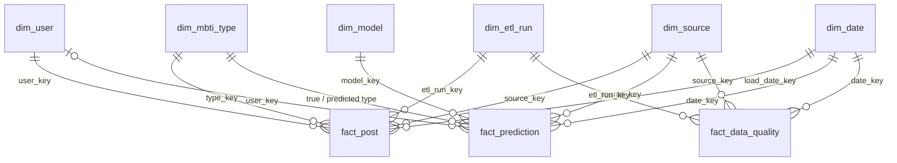

# PersonaLens: MBTI Personality Type Prediction

PersonaLens is an experimental data analytics project that explores how well machine learning
models can predict **self-reported** MBTI personality types from user-generated text.
Beyond classification, it includes an ETL pipeline, a PostgreSQL star-schema data warehouse,
and a BI dashboard for data profiling and model evaluation.

> ⚠️ MBTI has known scientific limitations. This project does not provide psychological
> diagnoses; predictions are probabilistic model outputs, not definitive personality assessments.

## Architecture

```
Data Source
    ↓
ETL with Python / Pandas (clean, transform, load)
    ↓
PostgreSQL Data Warehouse
    ↓
ML Model (TF-IDF + Logistic Regression; SVM as baseline comparison)
    ↓
Streamlit App & BI Dashboard
```

## Approach

- Four binary classifiers for the MBTI dimensions: **E/I**, **N/S**, **T/F**, **J/P**
- Combined outputs yield one of the 16 MBTI types
- Evaluation on users unseen during training (user-level split), using Macro-F1,
  Balanced Accuracy, Precision/Recall and confusion matrices
- MBTI codes are removed from the text to prevent data leakage

## Dataset

- [PersonalityCafe MBTI (preprocessed)](https://huggingface.co/datasets/Lazanantenaina/personalitycafe-mbti-preprocessed)
- Original: [Kaggle – MBTI Type](https://www.kaggle.com/datasets/datasnaek/mbti-type)

~8,675 users, ~50 forum posts each, 16 MBTI labels. Note: the data comes from the
PersonalityCafe forum, not from Twitter/X.

## Tech Stack

| Technology | Purpose |
|------------|---------|
| Python, Pandas | Data processing and ETL |
| scikit-learn | ML models and evaluation |
| PostgreSQL | Data warehouse |
| Streamlit | User interface and dashboard |
| Power BI | Optional additional BI visualizations |

## Getting Started

```powershell
git clone https://github.com/atakankhrmn/PersonaLens.git
cd PersonaLens
python -m venv .venv
.venv\Scripts\activate
pip install -r requirements.txt
```

Then open `notebooks/01_eda.ipynb` (VS Code or `jupyter notebook`) and run all cells.
The dataset (~80 MB per configuration) is downloaded on first run and cached in `data/raw/`.

### Cleaning ETL

Even the strictest Hugging Face config still leaks the label. Our ETL step
([src/etl/cleaning.py](src/etl/cleaning.py)) cleans every post:

| What | Examples | Replaced by |
|---|---|---|
| Encoding artefacts | `isnx92t`, `x93quotex94`, `u200b` | `isn't`, `"quote"`, `` |
| MBTI types in any form | `INFPs`, `mrinfj`, `I.N.F.J`, `INxJ`, `E_TJ`, `Ixxx`, `xxFx` | `<MBTI_TYPE>` |
| Partial codes & temperaments | `NFPs`, `NTJ`, `NT`, `SJs` | `<MBTI_TYPE>` |
| MBTI system words | `MBTI`, `Myers-Briggs`, `cognitive functions` | `<MBTI_TERM>` |
| Cognitive functions | `Fi`, `Ne-dom`, `NeTi` | `<COGNITIVE_FUNCTION>` |
| Socionics / Enneagram | `LII`, `SEE-Fi`, `4w5`, `sx/so` | `<TYPOLOGY_TERM>` |
| Placeholder-only posts | `<MBTI_TYPE>`, `' <URL>`, `.` | dropped |
| Copied templates (≥3 users, ≥8 words) | questionnaires, forum games | dropped |

Deliberately **kept**: words like *introvert*, *thinking*, *feeling* (genuine language signal;
"extrovert" users are only 25.7% E vs. a 23% base rate), stop words, and truncated posts.

```powershell
python -m src.etl.clean_leakage                 # label_clean (default, main training set)
python -m src.etl.clean_leakage --config all    # raw, label_clean, psychometric_clean
```

Outputs `data/processed/<config>_masked.parquet` and a before/after data-quality report
in `reports/etl/leakage_report_<config>.json`.

Results (users with any leak / with their **own** type in the text):

| Config | before | after |
|---|---:|---:|
| `raw` | 96.7% / 90.0% | 0% / 0% |
| `label_clean` (main) | 84.5% / 48.9% | 0% / 0% |
| `psychometric_clean` | 75.9% / 48.9% | 0% / 0% |

Why `label_clean` is the main base: after our cleaning the three configs are 98–99.7%
identical; the only difference to `psychometric_clean` is that HF wrongly masks
`Sci-Fi`/`Wi-Fi`/`Hi-Fi` there, while our rules already cover its extra masking.

All 8,675 users are kept; ~2,150 of ~409k posts (0.5%) are dropped and 2,187 encoding
artefacts are fixed. An independent check with different regexes finds no remaining
type codes, temperaments, cognitive functions or "MBTI" words.

Run the tests with `python -m pytest`. The Streamlit app must call the same
`src.etl.cleaning.clean_text` on user input so training and prediction text are cleaned identically.

### Loading data in your code

```python
from src.data_loader import load_clean, load_mbti

df = load_clean()                # label_clean + our cleaning → use this for models
pc = load_clean("psychometric_clean")  # same cleaning on another HF config, for comparison
raw = load_mbti("raw")           # original HF configs, e.g. for EDA
train = df[df["split"] == "train"]
```

## Data Warehouse (PostgreSQL)

A star schema in the `dw` schema of the `personalens` database ([src/dw/schema.sql](src/dw/schema.sql)).



| Table | Grain / content | Rows now |
|---|---|---:|
| `fact_post` | one cleaned post: words, chars, URLs, masks, truncated flag, cleaned text | 406,793 (main source only) |
| `fact_prediction` | one model prediction per user (or per app request, text not stored) | 0 (filled by ML step) |
| `fact_data_quality` | one ETL run × quality metric (leaks, artefacts, removed posts) | 87 |
| `dim_user` | anonymous user, split, self-reported type | 8,675 |
| `dim_mbti_type` | 16 types, 4 letters, temperament | 16 |
| `dim_source` | dataset config + cleaning variant (or the app) | 3 |
| `dim_model`, `dim_etl_run`, `dim_date` | models, load runs (lineage, git commit), calendar 2020–2035 | |

The dataset has no post dates, so `dim_date` only holds real dates (load date, prediction date).
BI views: `vw_type_distribution`, `vw_dimension_distribution`, `vw_user_profile`,
`vw_posts_by_type`, `vw_data_quality_latest`, `vw_model_performance`, `vw_confusion_matrix`.

### Setup (once per machine)

1. Install PostgreSQL 17 (`winget install PostgreSQL.PostgreSQL.17` or the installer from
   postgresql.org). **On a Turkish Windows** the default installer fails with
   *locale name "Turkish_Türkiye.1254" contains non-ASCII characters*; choose locale **C**
   (installer option `--locale C`) and UTF8 encoding.
2. Copy `.env.example` to `.env` and put your own postgres password into `DATABASE_URL`.
3. Load the warehouse (creates the `personalens` database and the schema automatically):

```powershell
python -m src.etl.clean_leakage --config all   # if data/processed/ is empty
python -m src.dw.load_dw                       # ~30 s, safe to re-run
```

Browse the tables with pgAdmin 4 (installed with PostgreSQL) or connect Power BI to
`localhost:5432`, database `personalens`, schema `dw`.

### Writing model results (ML step)

```python
from src.dw.db import get_engine
from src.dw.predictions import register_model, write_predictions

engine = get_engine()
key = register_model(engine, "tfidf_logreg", "v1", algorithm="TF-IDF + LogisticRegression",
                     metrics={"val_macro_f1": {...}})
write_predictions(engine, key, preds)  # columns: user_id, predicted_type, score_e/n/t/j
```

`vw_model_performance` and `vw_confusion_matrix` then show the results for the dashboard.
The app uses `log_app_prediction(...)`, which stores the prediction but never the user's text.

## Baseline Models

Four binary classifiers (E/I, N/S, T/F, J/P) on TF-IDF word 1–2-grams, `class_weight="balanced"`,
regularisation `C` tuned per dimension on the validation split. The four letters are combined
into the 16-type prediction.

```powershell
python -m src.models.train            # train LogReg + SVM, save models/, reports/models/, write to DW
python -m src.models.train --no-dw    # without PostgreSQL
```

Validation results (Macro-F1 / Balanced Accuracy):

| Model | E/I | N/S | T/F | J/P | 16 types |
|---|---|---|---|---|---|
| Majority baseline | 0.44 / 0.50 | 0.46 / 0.50 | 0.35 / 0.50 | 0.38 / 0.50 | 0.02 / 0.06 |
| TF-IDF + LogReg | 0.64 / 0.63 | 0.62 / 0.60 | 0.81 / 0.81 | 0.63 / 0.63 | 0.19 / 0.19 |
| TF-IDF + LinearSVC | 0.64 / 0.64 | 0.62 / 0.60 | 0.80 / 0.80 | 0.64 / 0.63 | 0.19 / 0.19 |

Final **test** results (Macro-F1 / Balanced Accuracy, one run with `--final-test`):

| Model | E/I | N/S | T/F | J/P | 16 types |
|---|---|---|---|---|---|
| Majority baseline | 0.44 / 0.50 | 0.46 / 0.50 | 0.35 / 0.50 | 0.38 / 0.50 | 0.02 / 0.06 |
| TF-IDF + LogReg | 0.66 / 0.65 | 0.60 / 0.58 | 0.79 / 0.79 | 0.63 / 0.63 | 0.20 / 0.20 |
| TF-IDF + LinearSVC | 0.66 / 0.65 | 0.60 / 0.58 | 0.79 / 0.79 | 0.63 / 0.63 | 0.20 / 0.20 |

Test: 36.9% exact 16-type match (majority baseline 21.2%), 3.06 of 4 letters right on average.
Known caveats (in-sample train predictions, placeholder tokens as features, scores are not
real-world probabilities, …) are listed in [AGENTS.md](AGENTS.md#baseline-results-and-caveats-read-before-using-or-changing-the-models). T/F is the easiest axis,
N/S the hardest. Top words per letter are in `reports/models/*.json`.

Using a model (e.g. in the app):

```python
from src.models.predict import predict
predict(["first post ...", "second post ..."])
# {"type": "INTP", "scores": {"EI": 0.21, "NS": 0.83, "FT": 0.66, "JP": 0.31},
#  "n_words": 512, "enough_text": True, "model": "tfidf_logreg v1"}
```

The input is cleaned with the same `clean_text` as the training data; `enough_text` is
False below 300 words and the app must show a warning then.

## Project Structure

```
PersonaLens/
├── app/              # Streamlit app
├── frontend/         # React + Vite web UI with Express proxy (see frontend/README.md)
├── data/
│   ├── raw/          # downloaded dataset (not tracked by git)
│   └── processed/    # ETL outputs (not tracked by git)
├── models/           # trained model files (not tracked by git)
├── notebooks/        # EDA and experiments
├── reports/
│   ├── etl/          # data-quality reports from ETL runs
│   ├── models/       # model reports (metrics, chosen C, top words)
│   └── figures/      # generated charts for dashboard / presentation
├── src/
│   ├── data_loader.py
│   ├── etl/          # cleaning rules, leakage ETL
│   ├── dw/           # star schema SQL, DW load, prediction writer
│   └── models/       # training and evaluation code
└── tests/            # pytest unit tests
```

## Key EDA Findings

- 8,675 users, ~47 posts each; 16-class imbalance of ~47:1 (INFP most, ESTJ least)
- Majority shares: I 77.0%, N 86.2%, F 54.1%, P 60.4% → use Macro-F1 / Balanced Accuracy
- User-level splits have no overlapping users
- **Leakage:** in `label_clean`, ~48.6% of users still have their *own* type in the text
  through suffixed forms such as `INFPs`; 45% mention cognitive functions, 24.5% temperament
  codes (NT/NF/SJ/SP), 18% Enneagram types → all removed by our cleaning ETL (see above)

## Using AI coding agents

[AGENTS.md](AGENTS.md) holds the shared context for AI coding agents (status, data rules,
cleaning, conventions); [CLAUDE.md](CLAUDE.md) imports it for Claude Code. Keep AGENTS.md
up to date when a step is finished.

## Project Plan

The full project plan (in Turkish) is available in [MBTI_DW_Proje_Plani.md](MBTI_DW_Proje_Plani.md).

## Status

🚧 EDA, cleaning ETL, PostgreSQL data warehouse and baseline models done; Streamlit app next.
